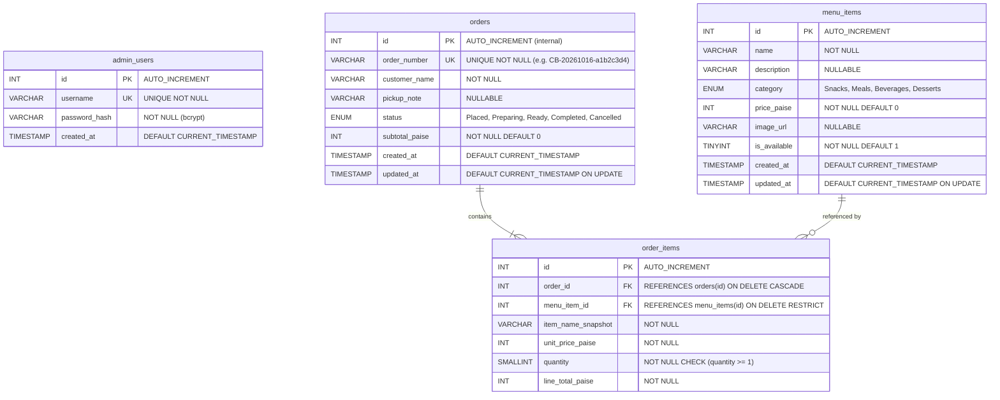

# CampusBite 🍽️
### Smart Campus Food Ordering and Order Management System

A complete, responsive, full-stack web application designed for a college cafeteria. Students can browse menu items, add food to a cart, place simulated orders, and track order progress in real-time. An authenticated administrator manages cafeteria menu items, toggles availability, and processes orders through an operational dashboard following a strict status workflow.

---

## 1. Features and Technology Stack

### Customer-Facing Features
- **Responsive Homepage & Menu**: Browse dynamic food items fetched directly from MySQL with category filtering (Snacks, Meals, Beverages, Desserts), search by item name, and live availability status.
- **Client-Side Cart with Persistence**: Add/remove items and adjust quantities (clamped 1–50) with `localStorage` persistence and dynamic navbar badges.
- **Secure Server-Calculated Checkout**: Frontend prices are treated as untrusted; the backend independently fetches database prices, computes line totals and order subtotals, and creates the order inside an atomic database transaction.
- **Real-Time Order Tracking**: Follow live order status (`Placed` → `Preparing` → `Ready` → `Completed`) with an interactive visual step timeline.
- **Local Order History**: Customer's recent order reference numbers are stored locally on the browser device for quick tracking without requiring customer account registration.

### Admin Dashboard & Management Features
- **Secure Admin Authentication**: Protected by bcrypt password hashing (10 salt rounds) and JSON Web Tokens (JWT) with rate limiting to prevent brute-force attacks.
- **Operational Metrics**: Real-time counter cards showing today's orders, total orders, active kitchen orders, and completed orders.
- **Order Management & Workflow Validation**: Search orders, filter by status, view historical item snapshots, and transition orders through authorized states.
- **Menu Management**: Full CRUD capabilities to add items, edit names/prices/categories, and toggle item availability in one click.

### Technology Stack
- **Frontend**: HTML5, CSS3, Vanilla JavaScript (ES6+), Bootstrap 5.3, Bootstrap Icons, Fetch API.
- **Backend**: Node.js, Express.js, `mysql2` (Promise API with connection pooling), `bcrypt`, `jsonwebtoken` (JWT), `dotenv`, `express-rate-limit`, `cors`.
- **Database**: MySQL 8.0+ with InnoDB engine (ACID compliant transactions, foreign keys, CHECK constraints).
- **Testing**: Node.js built-in test runner (`node:test`, `node:assert/strict`), `supertest`.

---

## 2. Architecture and Request Flow

```
┌─────────────────────────────────────────────────────────────┐
│                       Client Browser                        │
│   (index.html, menu.html, checkout.html, track-order.html,   │
│         orders.html, admin-login.html, admin.html)          │
└──────────────┬──────────────────────────────▲───────────────┘
               │ HTTP Requests (Fetch API)    │ JSON Responses
               ▼                              │
┌─────────────────────────────────────────────────────────────┐
│                     Express.js Backend                      │
│                                                             │
│   ┌─────────────────────────────────────────────────────┐   │
│   │ Middleware: CORS, JSON parser, Rate Limiter, Auth   │   │
│   └──────────────────────────┬──────────────────────────┘   │
│                              ▼                              │
│   ┌─────────────────────────────────────────────────────┐   │
│   │ Routers & Controllers:                              │   │
│   │  - /api/health                                      │   │
│   │  - /api/menu      (Public menu retrieval)           │   │
│   │  - /api/orders    (Order placement & tracking)      │   │
│   │  - /api/admin     (Auth, order ops, menu CRUD)      │   │
│   └──────────────────────────┬──────────────────────────┘   │
│                              ▼                              │
│   ┌─────────────────────────────────────────────────────┐   │
│   │ Order Service: Price validation, calculation,       │   │
│   │ transactional atomicity, order number generation    │   │
│   └──────────────────────────┬──────────────────────────┘   │
└──────────────────────────────┼──────────────────────────────┘
                               │ mysql2/promise Connection Pool
                               ▼
┌─────────────────────────────────────────────────────────────┐
│                    MySQL 8.0+ Database                      │
│        Tables: admin_users, menu_items, orders, order_items │
└─────────────────────────────────────────────────────────────┘
```

### Request Flow for Order Placement:
1. Customer submits cart and name via `POST /api/orders` sending only `menu_item_id` and `quantity`.
2. `orderValidator.js` checks request body structure and parameter bounds.
3. `orderService.js` fetches current active prices directly from `menu_items` using a parameterized query (`WHERE id IN (...)`).
4. Service verifies that all items exist, are available (`is_available = 1`), and quantities are valid.
5. Server recalculates line totals and overall subtotal in integer **paise**.
6. A dedicated connection is acquired from the pool; `beginTransaction()` is invoked.
7. Order is inserted into `orders`, generating a primary key `id` and unique `order_number`.
8. Order items are inserted into `order_items` with item name and price snapshots.
9. `commit()` completes the transaction. If any query fails, `rollback()` undoes changes.
10. The connection is returned to the pool in a `finally` block, and customer receives safe confirmation details.

---

## 3. Folder Structure

```
CampusBite/
├── client/
│   ├── index.html              # Customer homepage & featured items
│   ├── menu.html               # Menu browsing with search & category filters
│   ├── checkout.html           # Cart review, customer details & simulated order placement
│   ├── track-order.html        # Public order status tracking & visual timeline
│   ├── orders.html             # Locally stored order references on client device
│   ├── admin-login.html        # Administrator sign-in portal
│   ├── admin.html              # Administrator order workflow & menu management dashboard
│   ├── css/
│   │   └── style.css           # Custom styles, theme variables, status badges, timelines
│   └── js/
│       ├── api.js              # Centralized API fetch wrapper
│       ├── cart.js             # Cart module with localStorage persistence
│       ├── menu.js             # Menu page fetching, filtering, and add-to-cart logic
│       ├── checkout.js         # Checkout review, validation, and order placement
│       ├── track-order.js      # Order status lookup and dynamic step timeline
│       ├── orders.js           # Client local order history renderer
│       ├── admin-login.js      # Admin authentication & JWT token storage
│       └── admin.js            # Admin dashboard metrics, order processing & menu CRUD
├── server/
│   ├── package.json            # Dependencies and scripts (test, db:init, admin:setup)
│   ├── server.js               # Express application entry point & route registration
│   ├── .env.example            # Environment variable template
│   ├── .gitignore              # Node modules, environment files, and log exclusions
│   ├── src/
│   │   ├── config/
│   │   │   └── database.js     # MySQL connection pool & connection health check
│   │   ├── controllers/
│   │   │   ├── adminController.js # Admin authentication, order operations & menu CRUD
│   │   │   ├── menuController.js  # Public menu listing and single item details
│   │   │   └── orderController.js # Customer order placement & safe tracking retrieval
│   │   ├── middleware/
│   │   │   ├── authMiddleware.js  # JWT Bearer token authentication middleware
│   │   │   └── errorHandler.js    # Centralized error handler returning safe error payloads
│   │   ├── routes/
│   │   │   ├── admin.js        # Admin routes with rate limiter and auth guards
│   │   │   ├── health.js       # Health check route
│   │   │   ├── menu.js         # Public menu endpoints
│   │   │   └── orders.js       # Customer order endpoints
│   │   ├── services/
│   │   │   └── orderService.js # Server pricing calculation & multi-table transaction logic
│   │   ├── utils/
│   │   │   ├── initDatabase.js # Automated database schema & seed executor
│   │   │   ├── orderNumber.js  # Unpredictable order reference generator
│   │   │   └── setupAdmin.js   # Script to seed or update administrator user
│   │   └── validators/
│   │       ├── menuValidator.js  # Validation for menu item create/update
│   │       └── orderValidator.js # Validation for customer order placement
│   └── tests/
│       ├── api.test.js             # Supertest HTTP integration tests for all endpoints
│       ├── db_integration.test.js  # Database health & rollback integration tests
│       └── validators.test.js      # Unit tests for validators & order number generator
├── database/
│   ├── schema.sql              # MySQL DDL (admin_users, menu_items, orders, order_items)
│   └── seed.sql                # 15 realistic cafeteria items with prices in paise
└── README.md                   # Full documentation & interview answers
```

---

## 4. Database Design & Entity-Relationship (ER) Diagram

### Monetary Value Rule (Integer Paise)
All prices and totals are stored as non-negative integers representing **paise** (1 INR = 100 paise).
- Storing `2500` represents ₹25.00.
- Eliminates IEEE 754 floating-point rounding inaccuracies in financial calculations.
- Converted to rupees only when rendered in the user interface.

### Snapshot Rule
When an order is created, the item's name (`item_name_snapshot`) and unit price (`unit_price_paise`) are saved in `order_items`. If an administrator later edits the menu item's name or price in `menu_items`, historical orders remain accurate.

### Mermaid ER Diagram



---

## 5. Setup and Installation

### Prerequisites
- **Node.js** (v18.0 or later, tested with v24.15.0)
- **MySQL Server** (8.0 or later, local installation)

### Step 1: Clone or Navigate to the Workspace
```bash
cd d:\Projects\CampusBite
```

### Step 2: Configure Environment Variables
Inside `server/`, copy `.env.example` to `.env`:
```bash
cd server
copy .env.example .env
```
Edit `server/.env` with your local MySQL credentials:
```env
PORT=3000
DB_HOST=localhost
DB_PORT=3306
DB_USER=root
DB_PASSWORD=your_mysql_root_password
DB_NAME=campusbite

JWT_SECRET=campusbite_super_secret_jwt_key_at_least_32_chars_long!
JWT_EXPIRES_IN=8h

ADMIN_USERNAME=admin
ADMIN_PASSWORD=admin123
```

### Step 3: Install Dependencies
```bash
npm install
```

### Step 4: Initialize MySQL Database & Seed Data
You can initialize the database using either the built-in Node utility (recommended, requires no MySQL CLI in PATH) or the MySQL CLI:

**Option A — Node Utility (Recommended)**:
```bash
npm run db:init
```
This connects to your MySQL server, executes `database/schema.sql`, and populates `database/seed.sql` with 15 realistic cafeteria items.

**Option B — MySQL CLI**:
```bash
mysql -u root -p < ../database/schema.sql
mysql -u root -p < ../database/seed.sql
```

### Step 5: Seed the Initial Administrator Account
Run the admin setup utility to create the default admin account (`admin` / `admin123`):
```bash
npm run admin:setup
```

### Step 6: Start the Backend Server
```bash
npm start
```
The server will start listening at:
- **Server API**: `http://localhost:3000`
- **API Health Check**: `http://localhost:3000/api/health`
- **Client Frontend**: `http://localhost:3000`

### Step 7: Open the Frontend
Open `http://localhost:3000` in your web browser. You can navigate between:
- **Home**: `http://localhost:3000/index.html`
- **Menu**: `http://localhost:3000/menu.html`
- **Cart & Checkout**: `http://localhost:3000/checkout.html`
- **Track Order**: `http://localhost:3000/track-order.html`
- **My Orders**: `http://localhost:3000/orders.html`
- **Admin Portal**: `http://localhost:3000/admin-login.html`

---

## 6. REST API Documentation

### Public Endpoints

#### `GET /api/health`
Verifies backend server status and MySQL database connectivity.
- **Success Response (200 OK)**:
  ```json
  {
    "success": true,
    "data": {
      "status": "ok",
      "database": "connected",
      "timestamp": "2026-10-16T17:30:00.000Z"
    }
  }
  ```

#### `GET /api/menu`
Lists menu items with optional query filters.
- **Query Parameters**:
  - `search` (string): Filters items by name (substring match).
  - `category` (string): `Snacks` | `Meals` | `Beverages` | `Desserts`.
  - `available` (boolean): `true` | `false`.
- **Response (200 OK)**:
  ```json
  {
    "success": true,
    "data": [
      {
        "id": 1,
        "name": "Samosa (2 pcs)",
        "description": "Crispy golden pastry stuffed with spiced potatoes and peas.",
        "category": "Snacks",
        "price_paise": 2500,
        "image_url": "https://images.unsplash.com/...",
        "is_available": 1
      }
    ]
  }
  ```

#### `GET /api/menu/:id`
Retrieves a single menu item by ID. Returns 404 if not found.

#### `POST /api/orders`
Validates and places a customer order inside an atomic database transaction.
- **Request Body**:
  ```json
  {
    "customer_name": "Priya Sharma",
    "pickup_note": "Extra chutney please",
    "items": [
      { "menu_item_id": 1, "quantity": 2 },
      { "menu_item_id": 10, "quantity": 1 }
    ]
  }
  ```
- **Success Response (201 Created)**:
  ```json
  {
    "success": true,
    "data": {
      "order_number": "CB-20261016-a1b2c3d4",
      "subtotal_paise": 6500,
      "message": "Your order has been placed. This is a simulated system — no payment is processed."
    }
  }
  ```

#### `GET /api/orders/:orderNumber`
Returns customer-safe details of an order. Never exposes internal integer database IDs.
- **Response (200 OK)**:
  ```json
  {
    "success": true,
    "data": {
      "order_number": "CB-20261016-a1b2c3d4",
      "customer_name": "Priya Sharma",
      "pickup_note": "Extra chutney please",
      "status": "Placed",
      "subtotal_paise": 6500,
      "created_at": "2026-10-16T17:30:00.000Z",
      "items": [
        {
          "item_name_snapshot": "Samosa (2 pcs)",
          "unit_price_paise": 2500,
          "quantity": 2,
          "line_total_paise": 5000
        }
      ]
    }
  }
  ```

---

### Protected Administrator Endpoints
*All requests require header:* `Authorization: Bearer <jwt_token>`

#### `POST /api/admin/login` *(Public, Rate Limited: 10 attempts/15 min)*
- **Request Body**: `{ "username": "admin", "password": "admin123" }`
- **Response (200 OK)**: `{ "success": true, "data": { "token": "eyJhbGci..." } }`

#### `GET /api/admin/metrics` *(Protected)*
Returns operational statistics (today's orders, total orders, counts grouped by status).

#### `GET /api/admin/orders` *(Protected)*
Lists recent orders with optional `?status=` and `?search=` filters.

#### `GET /api/admin/orders/:orderNumber` *(Protected)*
Returns complete administrative order details including items and timestamps.

#### `PATCH /api/admin/orders/:orderNumber/status` *(Protected)*
Updates order status through the validated workflow:
`Placed` → `Preparing` → `Ready` → `Completed` (or `Cancelled` from `Placed`).
- **Request Body**: `{ "status": "Preparing" }`
- **Error Response on Invalid Transition (422 Unprocessable Entity)**:
  ```json
  {
    "success": false,
    "error": "Cannot transition from \"Ready\" to \"Placed\". Allowed: Completed."
  }
  ```

#### `POST /api/admin/menu` *(Protected)*
Creates a new menu item. Required fields: `name`, `category`, `price_paise`.

#### `PUT /api/admin/menu/:id` *(Protected)*
Updates an existing menu item.

#### `PATCH /api/admin/menu/:id/availability` *(Protected)*
Toggles menu item availability: `{ "is_available": true }` or `{ "is_available": false }`.

---

## 7. Testing and Verification

Run the test suite using Node.js built-in test runner:
```bash
cd server
npm test
```

### Tested Scenarios
1. **Health Check API**: Verifies `GET /api/health` returns status and database connection state.
2. **404 Route Handling**: Ensures unmatched API endpoints return standard error JSON.
3. **Order Validation**:
   - Rejects empty customer name.
   - Rejects customer name exceeding 100 characters.
   - Rejects missing or empty `items` array.
   - Rejects negative or non-integer `menu_item_id`.
   - Rejects quantities less than 1 or greater than 50.
   - Accepts valid order structure.
4. **Menu Validation**:
   - Rejects missing name on creation.
   - Rejects invalid categories not in allowed list.
   - Rejects negative `price_paise`.
   - Allows partial updates for `PUT /api/admin/menu/:id`.
5. **Order Number Generation**:
   - Verifies format `CB-YYYYMMDD-XXXXXXXX`.
   - Verifies sequential uniqueness using cryptographic randomness.
6. **Admin Authentication & Guards**:
   - Rejects missing credentials on login with 400.
   - Rejects unauthenticated requests to `/api/admin/orders` with 401.
   - Rejects invalid Bearer tokens with 401.
   - Rejects unauthenticated requests to `/api/admin/metrics`, `/api/admin/menu`, and status updates with 401.
7. **Database Integration & Rollback**:
   - Verifies database connectivity and query execution.
   - Verifies that ordering a non-existent item fails and rolls back the transaction.

---

## 8. Security Considerations & Limitations

- **Token Storage**: In this educational implementation, the JWT token is saved in the browser's `sessionStorage`. This keeps the token isolated to the browser tab and automatically clears it when closed. In production, tokens should ideally be stored in `httpOnly`, `Secure`, `SameSite=Strict` cookies to mitigate Cross-Site Scripting (XSS) risks.
- **Rate Limiting**: `express-rate-limit` is configured for `/api/admin/login` (maximum 10 attempts per 15 minutes per IP) to guard against brute-force password cracking.
- **No Client Price Trust**: The browser sends only IDs and quantities. The backend independently looks up prices from MySQL and computes totals.
- **Simulated Order System**: CampusBite does not collect financial details or process payments.

---

## 9. Interview Questions & Comprehensive Answers

### 1. Why did you choose CampusBite?
CampusBite addresses a universal problem in campus cafeterias: long queues during short break intervals. It demonstrates the full engineering lifecycle of a real-world web application: relational database design, atomic transaction processing, public and authenticated REST APIs, input sanitization, and responsive user experience without the cognitive overhead of heavy single-page application frameworks.

### 2. How does the frontend communicate with Express?
The frontend communicates asynchronously over HTTP using the native browser `Fetch API`. All requests and responses exchange JSON payloads via structured REST endpoints (`GET`, `POST`, `PUT`, `PATCH`). Centralized helper functions in `client/js/api.js` encapsulate the base URL, headers (`Content-Type: application/json` and `Authorization: Bearer <token>`), and error response parsing.

### 3. What is a REST API?
REST (Representational State Transfer) is an architectural style for networked systems. In CampusBite:
- **Resources** are modeled as URI paths (e.g., `/api/menu`, `/api/orders`).
- **Standard HTTP verbs** define the action: `GET` (read), `POST` (create), `PUT` (replace/update), `PATCH` (partial update), and `DELETE` (remove).
- **Statelessness**: Each request from the client contains all the context and credentials needed to fulfill it.
- **Standard status codes**: `200 OK`, `201 Created`, `400 Bad Request`, `401 Unauthorized`, `404 Not Found`, `422 Unprocessable Entity`, and `500 Internal Server Error`.

### 4. What is middleware in Express?
Middleware functions in Express have access to the request (`req`), response (`res`), and the `next` function in the application's request-response cycle. They can execute code, modify request/response objects, end the cycle, or invoke the next middleware. CampusBite uses middleware for CORS configuration, body parsing (`express.json()`), rate limiting on login, JWT verification (`requireAdmin`), static file serving, and centralized error handling (`errorHandler`).

### 5. Why are orders and order items separate tables?
This adheres to relational database normalization (Third Normal Form). An order can contain multiple menu items, and a menu item can appear in many orders (a Many-to-Many relationship). Creating `order_items` as an associative junction table allows:
- Atomic line items with individual quantities and snapshots.
- Accurate line total calculations without duplicating order headers (customer name, status, timestamps).
- Avoiding comma-separated values or text arrays in a single column, which would violate 1NF and prevent indexing.

### 6. What are primary keys and foreign keys?
- **Primary Key (PK)**: A column or set of columns that uniquely identifies each row in a table (`id` in `menu_items`, `orders`, and `order_items`).
- **Foreign Key (FK)**: A constraint that links a column in one table to the primary key of another table (`order_items.order_id` references `orders.id` with `ON DELETE CASCADE`, and `order_items.menu_item_id` references `menu_items.id` with `ON DELETE RESTRICT`). This enforces referential integrity and prevents orphan order items.

### 7. Why use MySQL?
MySQL with the InnoDB engine provides ACID (Atomicity, Consistency, Isolation, Durability) guarantees, which are non-negotiable for order management. It offers mature row-level locking, foreign key constraints, check constraints, transaction support, connection pooling, and structured indexing for performant querying.

### 8. What is a database transaction?
A database transaction is a sequence of database operations treated as a single, atomic unit of work. In CampusBite, inserting an order header and multiple order items is wrapped in `conn.beginTransaction()`. Either both the order and all its child line items succeed together, or the entire operation is discarded.

### 9. Why are commit and rollback important?
- `commit`: Persists all changes made during the transaction permanently to the database.
- `rollback`: Reverts any modifications made since `beginTransaction()` if an error occurs (such as an item becoming unavailable or a database constraint violation). This prevents half-written, corrupted state where an order exists without line items.

### 10. Why must the backend recalculate prices?
Client-side data is completely untrusted. Anyone can manipulate JavaScript objects in DevTools or send forged API payloads with a price of ₹0. CampusBite ignores any price sent in the HTTP request body; it queries MySQL directly for current active `price_paise` values and calculates all line totals and subtotals on the server.

### 11. What is SQL injection, and how do parameterized queries help?
SQL injection occurs when untrusted user input is directly concatenated into a SQL statement, allowing an attacker to manipulate the query logic (e.g. `' OR 1=1; --`). Parameterized queries using `?` placeholders (in `mysql2`) send the SQL query template and the user values to MySQL in separate protocol packets. MySQL treats the values strictly as literal data, completely neutralizing SQL injection risks.

### 12. What is connection pooling?
Creating and tearing down a TCP handshake and authentication session for every HTTP request is computationally expensive. A connection pool (`mysql.createPool`) maintains a set of pre-established, reusable database connections. When a request arrives, it borrows a connection, executes queries, and returns it to the pool in a `finally` block, significantly increasing throughput and resource efficiency.

### 13. What are bcrypt and JWT?
- **bcrypt**: A password hashing function designed with an adaptive work factor (salt rounds). It includes automatic random salt generation and slow computation to protect against rainbow table attacks and brute-force cracking.
- **JWT (JSON Web Token)**: A compact, URL-safe standard (RFC 7519) representing claims securely transferred between parties. It consists of a Header, Payload, and cryptographic Signature verified by the server using `JWT_SECRET`.

### 14. How does the admin authentication middleware work?
The `requireAdmin` middleware inspects the incoming `Authorization` HTTP header. It checks for the `Bearer <token>` format, extracts the token, and calls `jwt.verify(token, process.env.JWT_SECRET)`. If the signature is valid and has not expired, it attaches the decoded payload (`id`, `username`) to `req.admin` and calls `next()`. If missing or invalid, it halts execution and returns a `401 Unauthorized` response.

### 15. How does the order-status workflow work?
The order status moves through a finite state machine:
- `Placed` → can transition to `Preparing` or `Cancelled`.
- `Preparing` → can transition only to `Ready`.
- `Ready` → can transition only to `Completed`.
- `Completed` & `Cancelled` → terminal states (no further transitions permitted).
This logic is strictly validated on the backend in `adminController.js` before running the `UPDATE orders SET status = ?` query. Any illegal transition is rejected with a `422 Unprocessable Entity` status code.

### 16. How did you test the application?
The application was verified through:
- **Automated Unit Tests**: Testing validator rules (`orderValidator`, `menuValidator`) and random order reference generation.
- **Automated HTTP Integration Tests**: Using `supertest` with Node's native test runner to verify status codes, error structures, unauthorized admin rejections, and endpoint error handling.
- **Database Rollback Testing**: Verifying transactional aborts upon invalid or nonexistent menu items.
- **Manual End-to-End Testing**: Testing the customer workflow (Menu → Cart → Checkout → MySQL Order Creation → Tracking) and administrator workflow (Login → Order Status Updates → Menu CRUD).

### 17. What would you improve for production?
1. **Cookie-Based JWT Storage**: Store JWT tokens in `httpOnly`, `Secure`, `SameSite=Strict` cookies instead of `sessionStorage`.
2. **WebSocket / SSE Live Updates**: Implement Server-Sent Events (SSE) or WebSockets so the customer tracking screen and kitchen dashboard update in real-time without polling.
3. **Database Migrations**: Adopt a schema migration tool (e.g. Knex or Flyway) for automated version-controlled database schema evolution.
4. **Payment Gateway Integration**: Integrate Razorpay or Stripe webhooks to handle real financial transactions before order confirmation.
5. **Kitchen Display System (KDS)**: Add audio chime alerts and ticket printing support for kitchen staff.
